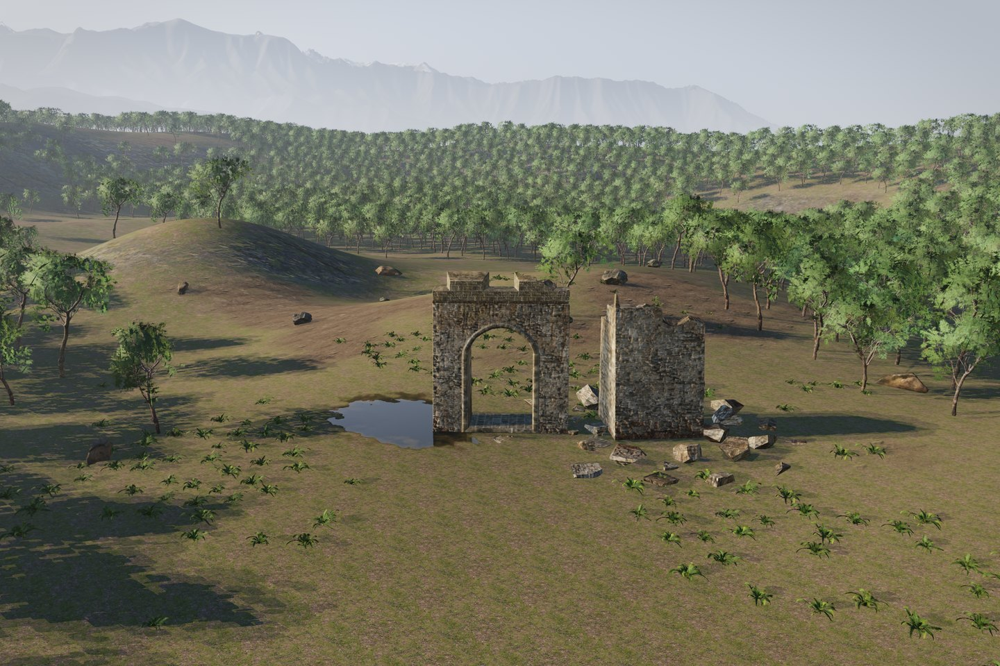
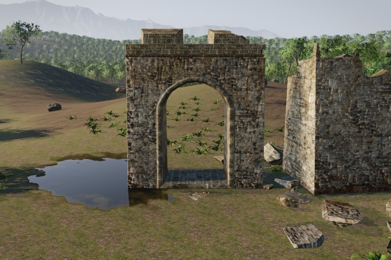
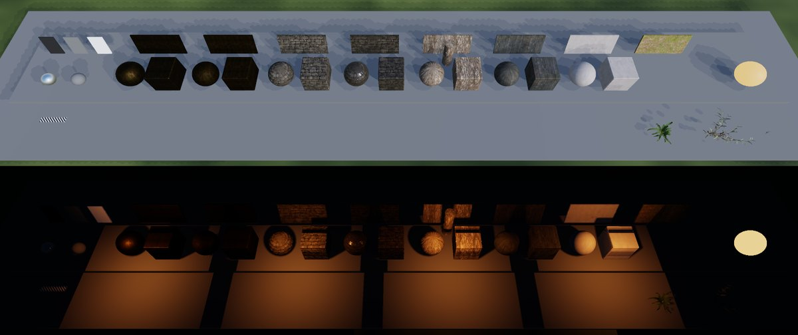

# Luxel Engine (still in development)

Luxel is an open-world game engine with a Vulkan renderer. Its target is the
look of current large open-world games: scanned materials, physically based
lighting, dense forests and kilometre-scale terrain.

The Rust core owns the world. It holds layouts, assets, gameplay rules and the
checks that decide what reaches the screen. The renderer and the terrain
solvers are written in Julia, and Python drives asset intake and tooling.



| | |
|---|---|
|  |  |

*Riverwatch, the reference scene: a damaged stone ruin built from scanned
CC0 models, broadleaf forest and an eroded mountain backdrop. On the right,
the material calibration board lit by sun and sky (top) and by warm local
point lights with cube-map shadows (bottom). All frames come straight from
the engine.*

## Status

Luxel is in active development and is not ready for production games. The
renderer handles the Riverwatch scene end to end. Cascaded sun shadows, local
light shadows, image-based lighting and the camera-relative shadow fix are
all in. The current work is the materials and lighting campaign, followed by
the first playable prototypes.

## Architecture

| Layer | Language | Location | Role |
|---|---|---|---|
| Authority | Rust | `world_core/` | Layouts, assets, gameplay, project ledger, scene lowering, render policy, receipts |
| Renderer | Julia, Vulkan | `graphics_lab/` | Lava-based Vulkan renderer: PBR shading, shadows, IBL, foliage, water |
| Terrain | Julia | `terrain_lab/` | Heightfield, erosion and hydrology solvers |
| Tooling | Python | `pipeline/`, `tools/` | Asset intake, content fetch and build, measurement, the native gate |
| Characters | JavaScript, Python | `character_lab/` | 2D character authoring workbench |

The Rust side lowers a world layout into a graphics scene packet. A Julia
worker process renders the packet and returns the frame, and Rust verifies
the result. Nothing in the renderer decides gameplay or asset validity.

## Requirements

- Linux and a Vulkan GPU. Development uses an NVIDIA RTX 5060.
- Rust 1.95 or newer.
- Julia 1.12, installed with [juliaup](https://github.com/JuliaLang/juliaup).
- Python 3 with NumPy and Pillow (`pip install -r requirements.txt`).
  Development uses Python 3.14.

The full Riverwatch scene also needs:

- Blender on `PATH`, to build the ruin kit.
- [Gaea 2](https://quadspinner.com/), run through Steam Proton, to build the
  mountain backdrop. `pipeline/gaea_build.py` lists the environment variables
  that locate it.

## Getting started

Instantiate the Julia projects once:

```sh
julia --project=terrain_lab -e 'using Pkg; Pkg.instantiate()'
julia --project=graphics_lab -e 'using Pkg; Pkg.instantiate()'
```

Build the Rust workspace and run the native gate:

```sh
cd world_core && cargo build && cd ..
python3 pipeline/luxel_native_gate.py
```

Render a quick top-down check frame of the reference layout (320×240, no
downloaded content needed). Run this from `world_core/`:

```sh
cargo run -q -p luxel-native-graphics-contract -- render-layout \
  crates/reference_runtime/examples/riverwatch.layout.json \
  julia "$PWD/../terrain_lab" "$PWD/../graphics_lab" \
  "$PWD/../graphics_lab/bin/luxel_graphics_worker.jl" out.ppm
```

### Full Riverwatch scene

The scanned content is not committed. Each set is pinned by a manifest with
URLs, sizes and SHA-256 digests. Each set downloads into the ignored
`artifacts/` tree:

```sh
python3 tools/fetch_terrain_layers.py tools/terrain_layers/converge0.json
python3 tools/fetch_models.py tools/models/kit1.json
python3 tools/build_kit.py --set kit2
python3 tools/build_backdrop.py --set backdrop1
```

Then render the wide, medium and close views with the current policy:

```sh
tools/parity_ab_policy.sh artifacts/riverwatch artifacts/riverwatch/render.log converge4
```

Set `LUXEL_JULIA` or `JULIA` if `julia` is not on your `PATH`.

## Tests

```sh
(cd world_core && cargo test)                                        # Rust
julia --project=graphics_lab graphics_lab/test/runtests.jl           # renderer protocol
(cd terrain_lab && julia --project=. test/runtests.jl)               # terrain solvers
python3 -m unittest discover -s tests                                # Python tooling
```

The GPU renderer suites in `graphics_lab/test/` run one at a time, since
they share the GPU.
Several tests use a large external GLB as a negative control. It is not in
the repository, so those tests skip unless `LUXEL_NEGATIVE_CONTROL_GLB`
points to it.

## Repository layout

```text
world_core/        Rust workspace: authority crates and the native graphics contract
graphics_lab/      Julia/Vulkan renderer, worker process and TetCage deformation lab
terrain_lab/       Julia terrain solvers
pipeline/          Python asset intake, native gate and integrations
tools/             Content manifests, fetch and build scripts, measurement tools
character_lab/     Character authoring workbench
assets/            Committed source art
engine_adapters/   Legacy Unity and Unreal export adapters
tests/             Python test suite
docs/              User docs: the Luxel language spec and README images
```

The docs index is [docs/README.md](docs/README.md).

## License

Apache License 2.0. See [LICENSE](LICENSE) and [NOTICE](NOTICE).
